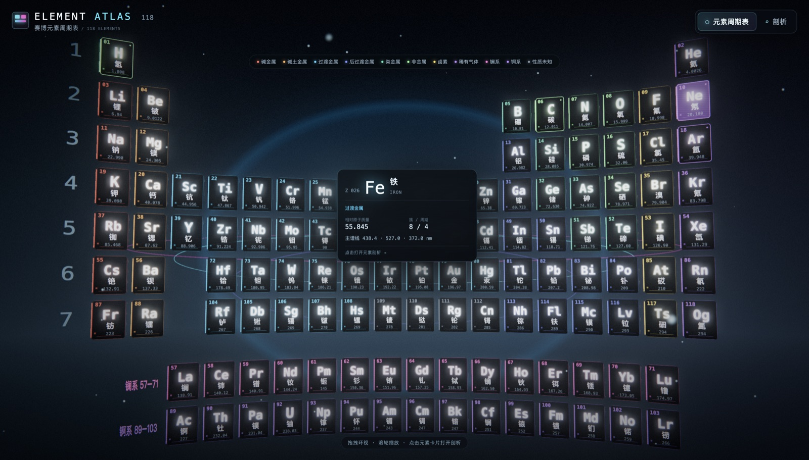

# Element Atlas 118 · 赛博元素周期表

一个完全离线可运行的 Three.js 3D 元素周期表：118 张元素卡片、玻尔原子模型、电子壳层、物理性质、常见化合物、特征反应和发射光谱。没有外部图片、3D 模型、字体文件或音频素材，所有视觉与交互都由代码在运行时生成。



## 功能

- **118 元素周期表**：一张 2880×1800 Canvas 图集 + 单个 InstancedMesh（1 个 draw call），卡片按真实周期表布局排布，支持悬停高亮、选中辉光和点击进入剖析。
- **元素搜索**：顶栏输入符号、中文名、英文名或原子序数（如 `Fe` / `铁` / `iron` / `26`），回车直达剖析；按 `/` 聚焦搜索框。
- **悬停大字卡**：鼠标停在任意元素上，旁边弹出大字号信息卡，显示符号、中文名、英文名、相对原子质量、族/周期、类别和主谱线。
- **元素剖析**：玻尔原子模型（质子 / 中子 / 电子壳层）、电子排布、物理性质、常见化合物、特征反应、特征发射光谱。
- **结构 / 辉光双视图**：结构视图关闭 bloom，显示真实数量的质子、中子和轨道标签；辉光视图按元素特征色做加色光晕。
- **左右切换元素**：剖析页底部有“上一个 / 下一个”按钮，也支持键盘 `←` / `→`，边界（H / Og）自动禁用。
- **电子暂停**：原子说明条右侧的 `⏸` 可以冻结电子当前位置和原子自转，再点继续。
- **档案放大**：右侧 ATOMIC PROFILE 卡片右上角的 `⤢` 可以展开为独立大卡，再点收起；窄屏 / 手机上通过左侧档案的“查看完整档案”打开底部大卡。
- **单文件离线构建**：`npm run build` 产出 `dist/neon-lab-3d.html`，双击即可打开，断网、无本地服务也能运行。


## 快速开始

### 直接打开交付版

```bash
open dist/neon-lab-3d.html
```

### 开发模式

```bash
npm install
npm run dev        # http://127.0.0.1:5183/
```

### 重新构建单文件

```bash
npm run build      # → dist/neon-lab-3d.html
```

## 操作

| 操作 | 说明 |
| --- | --- |
| 拖拽 | 环视 / 旋转 |
| 滚轮 | 缩放 |
| 点击元素卡片 | 打开元素剖析 |
| `/` | 聚焦元素搜索，`↑` / `↓` 选择、回车打开 |
| 悬停元素卡片 | 显示大字信息卡 |
| `←` / `→` | 剖析页切换上一个 / 下一个元素 |
| `1` / `2` | 切换周期表 / 剖析 |
| `Esc` | 返回元素周期表 |
| 双击画布 | 重置视角 |

## 数据说明

- 电子排布按 Aufbau 顺序计算，并按 NIST 基态数据修正 20 个例外元素（Cr、Cu、Nb、Mo、Ru、Rh、Pd、Ag、La、Ce、Gd、Pt、Au、Ac、Th、Pa、U、Np、Cm、Lr）；界面显示稀有气体简写，如 Cu `[Ar] 3d¹⁰ 4s¹`。
- 原子核的质子数 = Z，中子数 = 相对原子质量四舍五入后的质量数 − Z；核子按同心分层密堆积示意，**不是真实核壳层结构**。
- 轨道为经典玻尔模型示意，**不是真实量子轨道**。
- 部分元素使用实测精选谱线；缺少可靠谱线的元素使用确定性近似，并在界面上标注“模拟谱线”。
- 合成元素的物理性质为预测或未知，未知项以 `—` 表示。

## 技术

- Three.js 0.169 + Vite 5
- 程序化 Canvas 图集、Shader 光晕、UnrealBloomPass
- 单文件构建：`scripts/inline.mjs` 将 JS/CSS 内联进一个 HTML

## 目录

```
index.html              # HUD 结构与单文件入口
src/core/app.js         # 场景、模式、相机、交互
src/world/periodic.js   # 118 元素图集与卡片
src/world/atom.js       # 玻尔原子模型
src/data/elements.js    # 元素数据、谱线、物性、化合物、反应
src/ui/ui.js            # 面板、悬停卡、光谱绘制
src/style.css           # 暗调毛玻璃 HUD
scripts/inline.mjs      # 单文件构建
dist/                   # 构建产物
```

## License

[MIT](LICENSE) © 2026 mxppxm